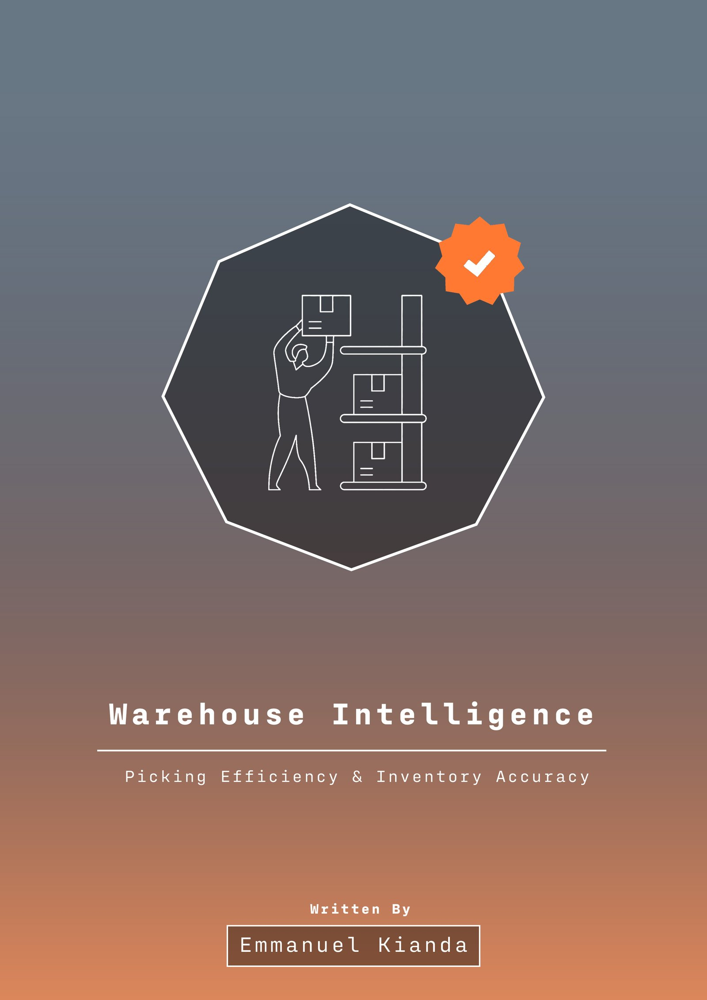
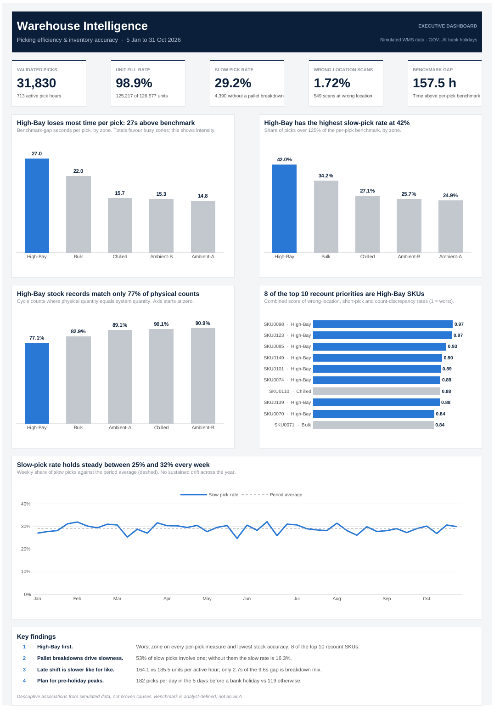
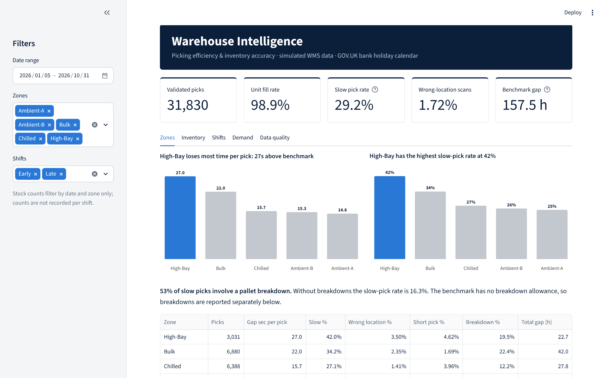

# Warehouse Intelligence: Picking Efficiency & Inventory Accuracy

**End-to-end data analysis project** | Python • pandas • SQL (SQLite) • Excel • Streamlit • REST API integration • Automated testing

## Overview

A UK retail distribution centre is dealing with slow pick completion, re-handling and unreliable stock locations. This project answers one business question:

**Which warehouse process problems should managers fix first, and how can they tell whether an improvement pilot worked?**

The project covers the full analytical workflow: multi-source raw data, cleaning and validation, a relational data model, SQL analysis, dashboards, automated data-quality tests and a management decision brief.

> **Data note:** Picking, SKU, roster and stock-count records are a realistic simulation generated by `src/generate_data.py` with a fixed seed. They are not records from any real company. Bank-holiday data comes from the official GOV.UK Bank Holidays API.

## Key results

| KPI | Result | Definition |
| --- | ---: | --- |
| Validated pick events | 31,830 | After deduplication and rejecting invalid records |
| Unit fill rate | 98.93% | Units picked / units requested |
| Slow pick rate | 29.2% | Picks taking over 125% of the per-pick benchmark |
| Wrong-location scans | 1.72% | Scanned location differs from SKU master location |
| Benchmark gap | 157.5 hours | Total time above benchmark (an opportunity signal, not proven savings) |
| High-Bay stock count accuracy | 77.1% | Physical count exactly matches system quantity |
| Units per active pick hour | 185.5 Early, 164.1 Late | Recorded picking time only, not paid hours |
| Slow picks involving pallet breakdown | 53% | Slow-pick rate falls to 16.3% without them |
| Picks per day before bank holidays | 181 vs 119 | 5 days before a bank holiday vs other operating days |

## Key findings and recommendations

1. **Prioritise High-Bay for stock-location checks.** High-Bay is the worst zone on every per-pick measure (42.0% slow, 3.50% wrong location, 4.62% short picks) and has the lowest stock count accuracy (77.1%). It ranks last on total delay hours only because it handles the fewest picks. 8 of the top 10 SKUs on a combined recount priority score are High-Bay.
2. **Review the pallet breakdown workflow, starting in Bulk.** Over half of all slow picks involve a pallet breakdown, and Bulk has the highest breakdown share (22.4%) and largest total delay (42.0 hours). Breakdown picks should be reported separately so the slow-pick KPI reflects other causes too.
3. **Investigate the Late shift before changing staffing.** Late moves about 11.5% fewer units per active hour. Around 2.7 of its 9.6 extra seconds per pick come from more breakdowns; the rest persists in like-for-like comparisons with near-identical SKU, zone and order-size mix.
4. **Plan labour around demand peaks.** Volume rises about 52% in the five days before a bank holiday, and Mondays and Fridays run about 25% above mid-week.
5. **Track measurable controls weekly** by zone and shift, with alert thresholds agreed with supervisors, and evaluate pilots by comparing the same SKUs, shifts and quantities before and after.

Full brief: [`reports/executive_brief.md`](reports/executive_brief.md)

## Dashboards

**Excel executive dashboard** (`dashboard/warehouse_intelligence_dashboard.xlsx`): a one-page view with KPI cards, finding-led charts and key findings, generated by `src/build_dashboard.py`. Every KPI and chart is formula-linked to the underlying data sheets.



**Streamlit app** (`dashboard/app.py`): interactive filtering by date, zone and shift, with tabs for zones, inventory, shifts, demand and data quality. Charts and headline titles recalculate for the selected filters.



## Data model and workflow

```text
[Raw WMS picks] ------------\
[SKU master + cycle counts] --> [pandas cleaning, validation, audit] --> [SQLite model]
[Shift rosters] ------------/                                         |
[GOV.UK Bank Holidays API] --> [Calendar dimension] -------------------|
                                                                      |
                                                              [SQL analysis views]
                                                                      |
                                                     [CSV extracts + executive brief]
                                                                      |
                                                      [Excel + Streamlit dashboards]
```

Each source has a different grain: picks are one row per picking event, cycle counts one row per SKU count, rosters one row per date and shift, and the calendar one row per day. Sources are aggregated to a common grain before joining so row counts are never inflated.

## Data cleaning and validation

- Removed **135 duplicate pick exports** using the unique event ID (verified as exact copies).
- Rejected **370 invalid picks** (275 missing or negative durations, 65 negative picked quantities, 30 unknown SKUs), each logged with a reason in `data/quality/rejected_picks.csv`.
- Normalised whitespace and casing in zones and location codes, preventing up to 150 false wrong-location flags.
- Reconciled zone and location against the SKU master as the reference record.
- Cleaned stock counts: removed 18 duplicates and rejected 27 invalid counts, each with a logged reason.
- Cross-checked derived flags against the WMS exception codes: every `MISLOC` and `SHORT` record matched.
- Found and fixed three pipeline bugs during review (a silently ignored weekday demand pattern, a reversed pre-holiday date flag and database views that never refreshed), each now covered by a regression test.

**13 automated tests** check uniqueness, value bounds, referential integrity, rollup reconciliation, audit reconciliation, source disclosure and calendar logic.

## SQL analysis

`sql/analysis_queries.sql` contains 10 business queries, including:

- Zone performance on both total impact and per-pick rates
- Pallet breakdown comparison within each zone
- Shift comparison, overall and like for like
- Stock count accuracy by zone
- Daily volume before bank holidays and by day of week
- A combined SKU recount priority score using window functions (`PERCENT_RANK`), joining pick and stock-count evidence at SKU level

## Run locally (macOS)

Requires Python 3.10 to 3.13; 3.12 recommended. Newer versions such as 3.15 are not yet supported by the pinned pandas release and can crash. Install with `brew install python@3.12`.

```bash
# From the project folder
python3.12 -m venv .venv
source .venv/bin/activate
pip install -r requirements.txt

# Refresh the GOV.UK bank holiday calendar (needs internet)
python3 src/fetch_bank_holidays.py

# Build the data, analysis outputs and dashboards
python3 src/generate_data.py
python3 src/clean_and_load.py
python3 src/build_report.py
python3 src/build_dashboard.py

# Run the 13 data-quality tests
python3 -m unittest discover -s tests -v

# Launch the interactive dashboard (opens in your browser)
streamlit run dashboard/app.py
```

Open the notebook with `jupyter notebook notebooks/analyst_walkthrough.ipynb`. To explore the SQL, open `warehouse_operations.sqlite` in [DB Browser for SQLite](https://sqlitebrowser.org/) and run queries from `sql/analysis_queries.sql`.

If the GOV.UK API is unreachable, the fetch script keeps the existing calendar file, so the pipeline still runs offline. Tests run automatically on every push via GitHub Actions (`.github/workflows/tests.yml`).

## Repository structure

```text
src/generate_data.py                 → reproducible simulated WMS data
src/fetch_bank_holidays.py           → GOV.UK Bank Holidays API ingestion
src/clean_and_load.py                → cleaning, validation, audit log, SQLite model
src/build_report.py                  → KPI extracts, metrics and executive brief
src/build_dashboard.py               → builds the Excel executive dashboard
sql/analysis_queries.sql             → 10 business queries
tests/test_data_quality.py           → 13 automated data-quality tests
notebooks/analyst_walkthrough.ipynb  → exploratory walkthrough
dashboard/                           → Excel dashboard and Streamlit app
docs/images/                         → dashboard screenshots
.github/workflows/tests.yml          → CI: rebuilds the pipeline and runs tests on every push
data/raw, data/processed             → source and cleaned datasets
data/quality                         → rejected records and audit summary
reports/                             → executive brief and metrics
warehouse_operations.sqlite          → queryable database
```

## Metric definitions and limitations

- **Benchmark:** `43 + 5.9 × units + 9 if SKU over 5 kg + 4 if High-Bay` seconds. An analyst-defined benchmark, not a business SLA, with no allowance for pallet breakdown.
- **Benchmark gap:** time above benchmark only; faster picks are not netted off. An opportunity signal, not a savings forecast.
- **Stock count accuracy:** measured per count event; some SKUs are counted more than once.
- **Throughput:** active picking time only; excludes breaks, travel between tasks and other duties.
- Findings are descriptive associations from simulated data, not proven causes.

## Conclusion & Reflection

This project allowed me to apply data analysis techniques to a realistic warehouse operations scenario, focusing on picking efficiency, inventory accuracy and operational performance. Using Python, SQL and Excel, I worked through the full analytical process, from data cleaning and validation to identifying patterns, visualising results and developing business recommendations.

The analysis covered 31,830 validated picking events and revealed several areas worth investigating. Although the overall unit fill rate was high at 98.93%, approximately 29.2% of picking events exceeded the defined time benchmark. High-Bay and Bulk zones showed particularly high rates of slower picks, suggesting opportunities to review stock positioning, inventory accuracy and pallet-handling processes.

One of the most valuable aspects of this project was learning to interpret findings within a business context. Rather than simply reporting performance figures, I focused on understanding what they could mean for warehouse operations and how management could use the information to make informed decisions. I also recognised the importance of distinguishing potential inefficiencies from proven causes, particularly when working with simulated data.

After completing the analysis, I ran the scripts locally, reviewed the outputs and verified that the different components worked together as intended. This strengthened my practical understanding of data preparation, SQL querying, automated validation and reporting.

Overall, this project reinforced my understanding that effective data analysis is not just about producing accurate calculations or visually appealing dashboards. It is about asking the right questions, ensuring the data is reliable and translating findings into practical recommendations that support better business decisions.

As a next step, I would like to develop the project further by introducing more advanced performance monitoring, interactive dashboards and additional data sources to explore how operational efficiency changes over time.
